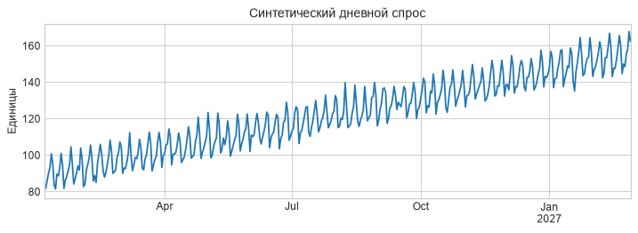
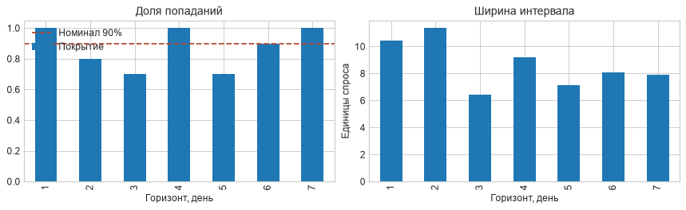

# Лабораторная работа 4. Базовые прогнозы и проверка качества

Цель — сравнить пять базовых моделей на горизонте одной недели, оценить интервалы прогноза и измерить эффект утечки. Данные имитируют ежедневный спрос с линейным ростом, недельным профилем и случайным шумом.

<details>
<summary>Код расчёта</summary>

```python
import numpy as np
import pandas as pd
import matplotlib.pyplot as plt
from statsmodels.tsa.forecasting.theta import ThetaModel

plt.style.use("seaborn-v0_8-whitegrid")
plt.rcParams["figure.dpi"] = 85
rng = np.random.default_rng(404)
m = H = 7
t = np.arange(420)
weekday_effect = np.array([-5, -2, 0, 3, 7, 15, 9])
y = pd.Series(85 + 0.16 * t + weekday_effect[t % m] + rng.normal(0, 1.9, len(t)),
              index=pd.date_range("2026-01-05", periods=len(t), freq="D"),
              name="Спрос")
y.plot(figsize=(10, 3), title="Синтетический дневной спрос", ylabel="Единицы")
plt.show()

models = {
    "Naive": lambda train: np.repeat(train.iloc[-1], H),
    "Seasonal Naive": lambda train: np.resize(train.iloc[-m:].to_numpy(), H),
    "Mean": lambda train: np.repeat(train.mean(), H),
    "Drift": lambda train: train.iloc[-1] + np.arange(1, H + 1)
        * (train.iloc[-1] - train.iloc[0]) / (len(train) - 1),
    "Theta": lambda train: ThetaModel(train, period=m, deseasonalize=True,
                                      use_test=False, method="additive").fit().forecast(H).to_numpy(),
}
```

</details>



Десять неперекрывающихся тестовых недель одинаковы в обеих схемах. Expanding использует всю доступную историю, sliding — последние 28 дней. Для каждого фолда MASE масштабируется средней абсолютной ошибкой сезонной разности на его обучающем отрезке. При одинаковом масштабе внутри фолда MASE и MAE ранжируют модели одинаково. Между фолдами масштаб может меняться.

<details>
<summary>Код расчёта</summary>

```python
origins = np.arange(len(y) - 10 * H, len(y), H)
records = []
for scheme, window in (("Expanding", None), ("Sliding (28 дней)", 28)):
    for origin in origins:
        start = 0 if window is None else origin - window
        train = y.iloc[start:origin]
        test = y.iloc[origin:origin + H]
        assert train.index.max() < test.index.min()
        scale = train.diff(m).abs().dropna().mean()
        actual = test.to_numpy()
        for name, model in models.items():
            forecast = model(train)
            ae = np.abs(actual - forecast)
            for h in range(H):
                records.append({
                    "Схема": scheme, "Модель": name, "Фолд": origin, "h": h + 1,
                    "MAE": ae[h], "MSE": ae[h] ** 2,
                    "MAPE %": 100 * ae[h] / abs(actual[h]),
                    "sMAPE %": 200 * ae[h] / (abs(actual[h]) + abs(forecast[h])),
                    "MASE": ae[h] / scale,
                })
point = pd.DataFrame(records)
table = point.groupby(["Схема", "Модель"])[["MAE", "MSE", "MAPE %", "sMAPE %", "MASE"]].mean()
table.insert(1, "RMSE", np.sqrt(table.pop("MSE")))
display(table.sort_values(["Схема", "MASE"]).round(3))
fold_mae = point.groupby(["Схема", "Модель", "Фолд"])["MAE"].mean()
ranking = pd.DataFrame({metric: table.groupby(level=0)[metric].idxmin().map(lambda key: key[1])
                        for metric in ("MASE", "MAE", "RMSE")})
instability = fold_mae.groupby(level=[0, 1]).std()
display(ranking)
display(instability.unstack(0).round(3).rename_axis("SD недельных MAE"))
```

</details>

<table border="1" class="dataframe">
  <thead>
    <tr >
      <th></th>
      <th></th>
      <th>MAE</th>
      <th>RMSE</th>
      <th>MAPE %</th>
      <th>sMAPE %</th>
      <th>MASE</th>
    </tr>
    <tr>
      <th>Схема</th>
      <th>Модель</th>
      <th></th>
      <th></th>
      <th></th>
      <th></th>
      <th></th>
    </tr>
  </thead>
  <tbody>
    <tr>
      <th rowspan="5" valign="top">Expanding</th>
      <th>Theta</th>
      <td>1.592</td>
      <td>2.146</td>
      <td>1.058</td>
      <td>1.059</td>
      <td>0.696</td>
    </tr>
    <tr>
      <th>Seasonal Naive</th>
      <td>2.241</td>
      <td>2.931</td>
      <td>1.492</td>
      <td>1.503</td>
      <td>0.979</td>
    </tr>
    <tr>
      <th>Naive</th>
      <td>7.642</td>
      <td>9.255</td>
      <td>5.230</td>
      <td>5.059</td>
      <td>3.337</td>
    </tr>
    <tr>
      <th>Drift</th>
      <td>7.776</td>
      <td>9.461</td>
      <td>5.334</td>
      <td>5.145</td>
      <td>3.396</td>
    </tr>
    <tr>
      <th>Mean</th>
      <td>31.221</td>
      <td>32.134</td>
      <td>20.546</td>
      <td>23.007</td>
      <td>13.624</td>
    </tr>
    <tr>
      <th rowspan="5" valign="top">Sliding (28 дней)</th>
      <th>Theta</th>
      <td>1.906</td>
      <td>2.514</td>
      <td>1.271</td>
      <td>1.273</td>
      <td>0.871</td>
    </tr>
    <tr>
      <th>Seasonal Naive</th>
      <td>2.241</td>
      <td>2.931</td>
      <td>1.492</td>
      <td>1.503</td>
      <td>1.010</td>
    </tr>
    <tr>
      <th>Mean</th>
      <td>6.630</td>
      <td>7.954</td>
      <td>4.333</td>
      <td>4.407</td>
      <td>2.961</td>
    </tr>
    <tr>
      <th>Naive</th>
      <td>7.642</td>
      <td>9.255</td>
      <td>5.230</td>
      <td>5.059</td>
      <td>3.432</td>
    </tr>
    <tr>
      <th>Drift</th>
      <td>8.881</td>
      <td>10.335</td>
      <td>6.083</td>
      <td>5.842</td>
      <td>3.987</td>
    </tr>
  </tbody>
</table>

<table border="1" class="dataframe">
  <thead>
    <tr >
      <th></th>
      <th>MASE</th>
      <th>MAE</th>
      <th>RMSE</th>
    </tr>
    <tr>
      <th>Схема</th>
      <th></th>
      <th></th>
      <th></th>
    </tr>
  </thead>
  <tbody>
    <tr>
      <th>Expanding</th>
      <td>Theta</td>
      <td>Theta</td>
      <td>Theta</td>
    </tr>
    <tr>
      <th>Sliding (28 дней)</th>
      <td>Theta</td>
      <td>Theta</td>
      <td>Theta</td>
    </tr>
  </tbody>
</table>

<table border="1" class="dataframe">
  <thead>
    <tr >
      <th>Схема</th>
      <th>Expanding</th>
      <th>Sliding (28 дней)</th>
    </tr>
    <tr>
      <th>SD недельных MAE</th>
      <th></th>
      <th></th>
    </tr>
  </thead>
  <tbody>
    <tr>
      <th>Drift</th>
      <td>1.236</td>
      <td>1.587</td>
    </tr>
    <tr>
      <th>Mean</th>
      <td>1.914</td>
      <td>0.918</td>
    </tr>
    <tr>
      <th>Naive</th>
      <td>1.114</td>
      <td>1.114</td>
    </tr>
    <tr>
      <th>Seasonal Naive</th>
      <td>0.759</td>
      <td>0.759</td>
    </tr>
    <tr>
      <th>Theta</th>
      <td>0.674</td>
      <td>0.717</td>
    </tr>
  </tbody>
</table>

## Интервалы Seasonal Naive

На 30 отдельных исторических неделях собираем знаковые ошибки «факт минус прогноз». Для каждого горизонта прибавляем к точечному прогнозу эмпирические квантили ошибок 0,05 и 0,95. Проверяем покрытие и ширину на десяти следующих неделях.

<details>
<summary>Код расчёта</summary>

```python
def weekly_errors(origin):
    return y.iloc[origin:origin + H].to_numpy() - models["Seasonal Naive"](y.iloc[:origin])

calibration_origins = np.arange(origins[0] - 30 * H, origins[0], H)
assert calibration_origins[-1] + H <= origins[0]
calibration = np.array([weekly_errors(origin) for origin in calibration_origins])
test_errors = np.array([weekly_errors(origin) for origin in origins])
lower, upper = np.quantile(calibration, [0.05, 0.95], axis=0)
intervals = pd.DataFrame({
    "Покрытие": ((test_errors >= lower) & (test_errors <= upper)).mean(axis=0),
    "Ширина": upper - lower,
}, index=pd.Index(np.arange(1, H + 1), name="Горизонт, день"))
display(intervals.round(3))
fig, axes = plt.subplots(1, 2, figsize=(10, 3), layout="constrained")
intervals["Покрытие"].plot.bar(ax=axes[0], ylim=(0, 1.05), title="Доля попаданий")
axes[0].axhline(0.9, ls="--", color="#ae492f", label="Номинал 90%")
axes[0].legend()
intervals["Ширина"].plot.bar(ax=axes[1], title="Ширина интервала", ylabel="Единицы спроса")
plt.show()
print(f"Общее покрытие: {intervals['Покрытие'].mean():.1%}, "
      f"средняя ширина: {intervals['Ширина'].mean():.2f}.")
```

</details>

<table border="1" class="dataframe">
  <thead>
    <tr >
      <th></th>
      <th>Покрытие</th>
      <th>Ширина</th>
    </tr>
    <tr>
      <th>Горизонт, день</th>
      <th></th>
      <th></th>
    </tr>
  </thead>
  <tbody>
    <tr>
      <th>1</th>
      <td>1.0</td>
      <td>10.450</td>
    </tr>
    <tr>
      <th>2</th>
      <td>0.8</td>
      <td>11.361</td>
    </tr>
    <tr>
      <th>3</th>
      <td>0.7</td>
      <td>6.449</td>
    </tr>
    <tr>
      <th>4</th>
      <td>1.0</td>
      <td>9.196</td>
    </tr>
    <tr>
      <th>5</th>
      <td>0.7</td>
      <td>7.131</td>
    </tr>
    <tr>
      <th>6</th>
      <td>0.9</td>
      <td>8.064</td>
    </tr>
    <tr>
      <th>7</th>
      <td>1.0</td>
      <td>7.890</td>
    </tr>
  </tbody>
</table>



```text
Общее покрытие: 87.1%, средняя ширина: 8.65.
```

## Эксперимент с утечкой

Для наглядности используем один и тот же алгоритм ближайшего сезонного соседа на одинаковых тестовых датах. Для случайного разбиения ближайший сосед того же дня недели может находиться в будущем. Отдельный учебный ряд с резкими недельными сдвигами показывает, почему такие соседи занижают ошибку. При честной оценке для всех семи прогнозов запрещены наблюдения начиная с даты выпуска прогноза.

<details>
<summary>Код расчёта</summary>

```python
leak_rng = np.random.default_rng(405)
# Уровень меняется между четырёхнедельными блоками.
block_levels = leak_rng.normal(0, 20, int(np.ceil(len(y) / 28)))
demo = 100 + weekday_effect[t % m] + block_levels[t // 28] + leak_rng.normal(0, 1, len(t))
shuffled = leak_rng.permutation(len(demo))
random_train = np.sort(shuffled[:int(0.8 * len(demo))])
random_test = np.sort(shuffled[int(0.8 * len(demo)):])
demo_origins = (random_test // H) * H
valid = demo_origins >= 2 * H
random_test, demo_origins = random_test[valid], demo_origins[valid]

def seasonal_neighbor(target, origin, chronological):
    candidates = random_train[random_train % m == target % m]
    if chronological:
        candidates = candidates[candidates < origin]
    if not len(candidates):
        return None
    return candidates[np.argmin(np.abs(candidates - target))]

pairs = []
for target, origin in zip(random_test, demo_origins):
    honest = seasonal_neighbor(target, origin, True)
    leaked = seasonal_neighbor(target, origin, False)
    if honest is not None and leaked is not None:
        pairs.append((target, honest, leaked))
target, honest, leaked = np.array(pairs).T
assert np.all(honest < (target // H) * H)
honest_mae = np.abs(demo[target] - demo[honest]).mean()
leaked_mae = np.abs(demo[target] - demo[leaked]).mean()
print(f"Одинаковых тестовых дат: {len(target)}")
print(f"Доля прогнозов со значениями из будущего: {(leaked > target).mean():.1%}")
print(f"Хронологическая MAE: {honest_mae:.2f}")
print(f"MAE со случайным split: {leaked_mae:.2f}")
print(f"Изменение MAE при утечке: {(leaked_mae / honest_mae - 1):+.1%}")
```

</details>

```text
Одинаковых тестовых дат: 83
Доля прогнозов со значениями из будущего: 13.3%
Хронологическая MAE: 10.46
MAE со случайным split: 9.77
Изменение MAE при утечке: -6.6%
```

### Выводы

- Theta выиграл по MASE, MAE и RMSE в обеих схемах. Расширяющееся окно принесло ему меньшую MAE (1,592 против 1,906) и немного меньший разброс недельной MAE (0,674 против 0,717). Для этого ряда выбираем Theta и расширяющееся окно. Для ежедневного спроса MAE легко перевести в число единиц недопоставки или излишка при одинаковой цене этих ошибок. RMSE сильнее учитывает редкие большие ошибки. MASE показывает результат относительно сезонного масштаба.
- Разброс недельной MAE описывает стабильность оценки на выбранных фолдах. Sliding может быстрее реагировать на смену уровня, а expanding использует больше данных и подходит при стабильной структуре.
- Общее покрытие составило 87,1% при номинале 90%, средняя ширина — 8,65 единицы. На горизонтах 3 и 5 дней покрытие было 70%. По десяти наблюдениям на горизонт возможны только шаги по 10 п. п., поэтому оценки покрытия шумные. Ширина нужна, чтобы отличить полезный интервал от чрезмерно широкого.
- Случайное разбиение использовало будущие значения для 13,3% прогнозов и занизило MAE на 6,6% (9,77 против 10,46). Разницу MAE в диагностическом опыте нельзя считать ожидаемым улучшением прогноза при внедрении.
